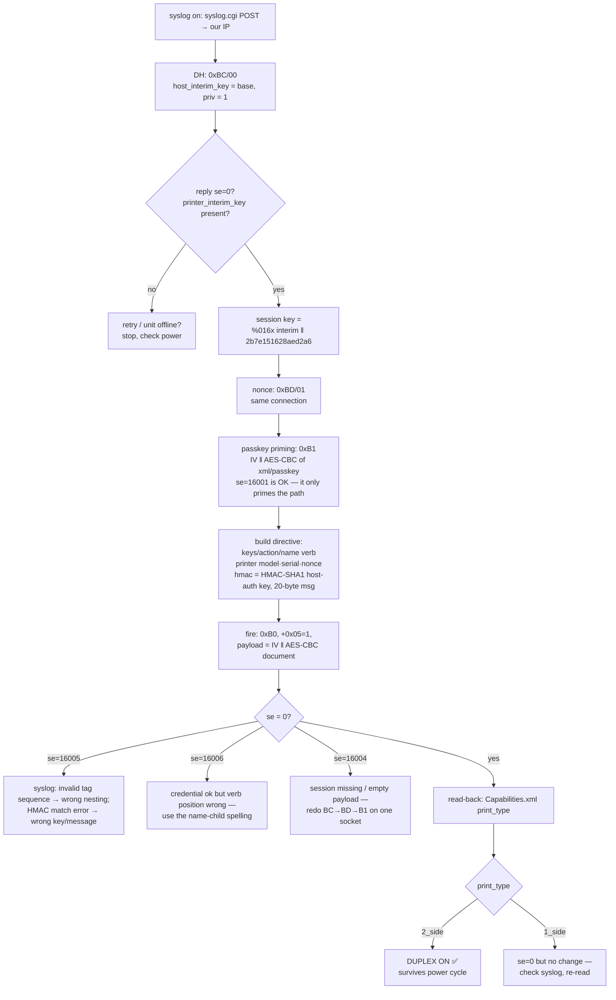
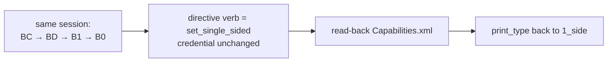
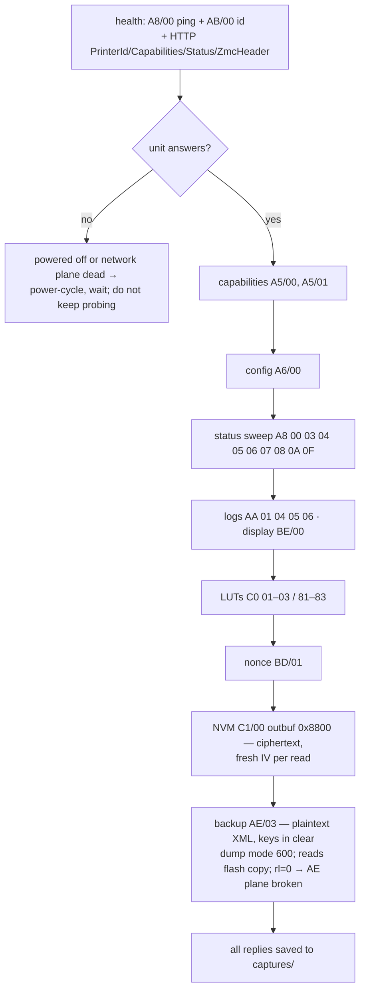
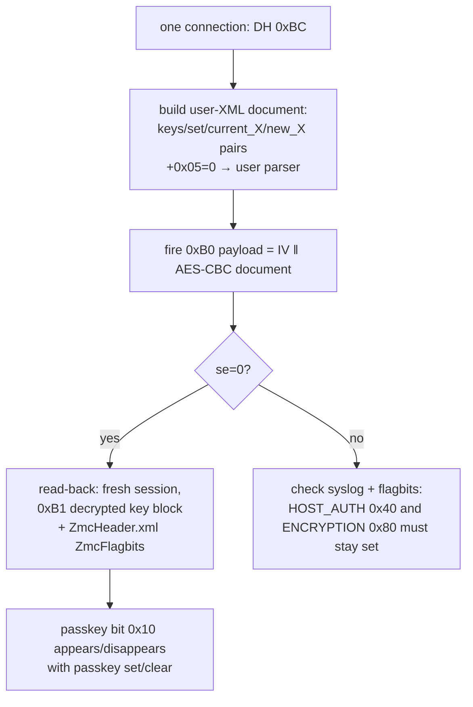
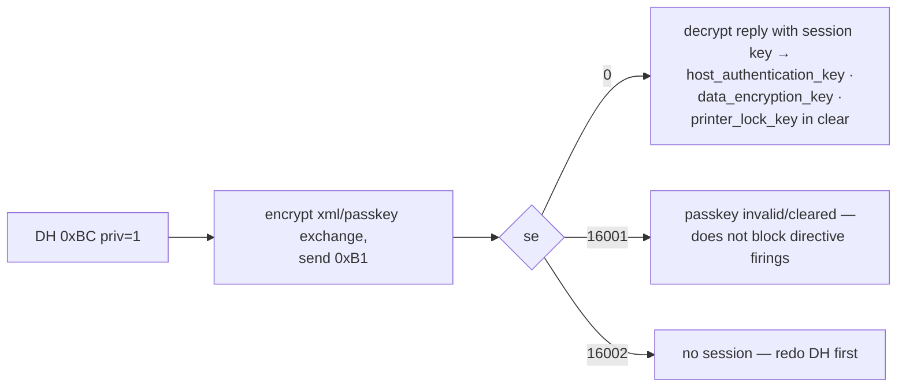
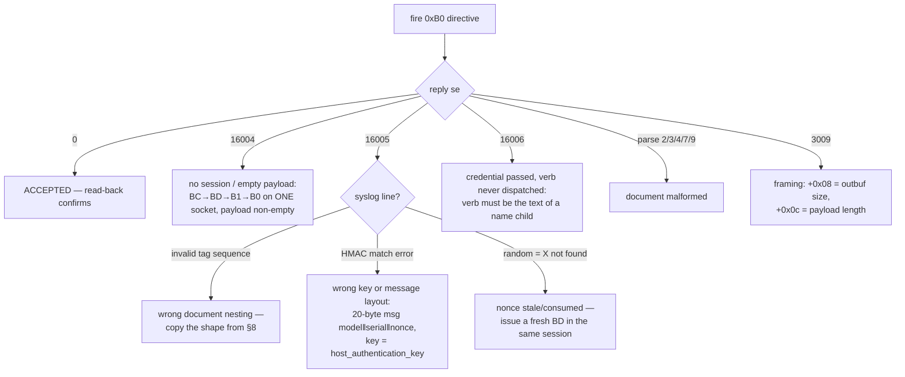

# The Zebra ZXP Series 7 ZMC1 protocol

Recovered from the vendor host binaries (`ZXPProt.dll`, `PxZMJ.dll`,
`ZXPToolbox.exe`), vendor pcaps, static analysis of the shipped application
image, and ~70 live probe sessions against one lab unit (FW
`FZ7MG.03.08.00`) between 2026-10-24 and 2026-11-23. The unit's identifying
values — serial, addresses, credentials, installed keys — are deliberately
withheld from this publication; worked examples use synthetic demo values.

Everything marked **live** was verified against the unit (reply bytes and/or
the firmware's own syslog lines). Confidence levels are stated where a claim
rests on static evidence only.

**Scope note.** Every operation verified here uses **OEM-supplied command sets** —
opcodes the firmware itself ships and the vendor Toolbox itself sends, including
the secure-action verbs (`set_double_sided` / `set_single_sided`) that are Zebra's
own designed interface for this capability. No exploit is used on the unlock path.
Weaknesses found by the audit are deliberately **not documented in this file**:
they are withheld and held for disclosure to Zebra, and `zmc_tool.py` refuses the
destructive ones and never requests anything outside its proven-safe allow-list.
See the README's *Disclaimer & scope*.

---

## Contents

1. [Transport & pacing](#1--transport--pacing)
2. [Request header](#2--request-header)
3. [Reply header](#3--reply-header)
4. [Status codes & flagbits](#4--status-codes--flagbits)
5. [Command set](#5--command-set)
6. [Session crypto — DH + AES-128](#6--session-crypto--dh--aes-128)
7. [Nonces and one-time use](#7--nonces-and-one-time-use)
8. [Secure actions — the grammar and the credential](#8--secure-actions--the-grammar-and-the-credential)
9. [The syslog verdict oracle](#9--the-syslog-verdict-oracle)
10. [The HTTP plane and how it mirrors ZMC](#10--the-http-plane-and-how-it-mirrors-zmc)
11. [Flow charts — jobs with `zmc_tool.py`](#11--flow-charts--jobs-with-zmc_toolpy)
12. [Appendix — a directive, byte by byte (synthetic demo)](#12--appendix--a-directive-byte-by-byte-synthetic-demo)

---

## 1 · Transport & pacing

**Live.** Plain TCP on port **9100**. One request, one reply, connection
closes. The firmware paces replies at ~10–17 s and slows further under load —
the lab policy (and the tool default) is **≥ 12 s between contacts**, one
connection per operation. Multi-frame sessions (DH → nonce → B1 → B0) keep a
single socket open; that is a *one* experiment.

The vendor Toolbox talks only to TCP/9100 — the HTTP plane (§10) is a separate
surface.

## 2 · Request header

16 bytes, payload at `+0x10`:

```
offset  size  field
+0x00   4     magic "ZMC1"                     (LE u32 0x31434D5A)
+0x04   1     primary opcode                   (e.g. 0xB0)
+0x05   1     sub-command  OR  encrypted-flag  (see note)
+0x06   1     0 (vendor SendCmdOutData param)
+0x07   1     0
+0x08   4     u32 output-buffer size offered   ("allowed" in firmware text — NOT a length)
+0x0c   4     u32 payload length               payload starts at +0x10
```

Equivalent view: a u16 command word at `+0x04` = `primary | (sub << 8)` — this
parsed all 794 packets of the vendor capture.

**Two traps, both live-caught:**

* The sub belongs at `+0x05`, not `+0x06`. Early harnesses got this wrong and
  every sub-dependent command (`A5`, `A8`, `C0`) silently ran `sub=0`.
* `+0x08` is the **buffer size you offer**, `+0x0c` is the **payload length**.
  Swapping them produces `se=3009` (`xml too big: N (allowed=M)`) on every
  XML-bearing command — this bug made a whole opcode inventory look dead.

For `0xB0`/`0xBD` the `+0x05` byte is *not* a sub: the vendor sends `1`,
meaning "payload is encrypted" (a flag=1 frame with no session or with an
empty payload is refused `se=16004`). For `0xB0` the byte additionally picks
the parser: `0` = user XML (`<keys><set>`), `1` = special XML (credential +
directive).

## 3 · Reply header

32 bytes, payload at `+0x20`:

```
offset  size  field
+0x04   2     u16 command echo — a genuine reply echoes the request's own word
+0x0c   1     flagbits (see §4)
+0x0d   2     u16 status "se"  (0 = ok)
+0x16   2     u16 printer error "so"  (e.g. 5001 = out of ribbon)
+0x1c   4     u32 reply payload length "rl"
+0x20   rl    payload — XML plaintext, or ciphertext (IV ‖ AES-CBC) per opcode
```

Firmware corroboration, live: `SendZMotifResponse(); Error+Flag: (err<<8)|flagbits`.

**The global reply buffer (live, 2026-11-20).** Reply headers are global, not
per-connection: when a command dispatches nothing, the firmware re-sends the
**previous reply byte-for-byte** across a fresh connection — command echo,
buffer echo, `se`, `rl` included. Consequences:

* A header cannot be used to attribute an answer — compare the command echo at
  `+0x04` against what you sent, and compare the whole reply against the last
  one you received. A mismatch = **no reply of your own** (e.g. `0xC2`, see
  §5).
* It leaks metadata across connections: a `C2` frame once returned
  `rl=15247` — the size of a backup document another host had just read.

## 4 · Status codes & flagbits

| `se` | Meaning | Evidence |
|---|---|---|
| `0` | success | all read opcodes; key writes; the accepted directive |
| `2,3,4,7,9` | expat parse errors (`syntax error`, `no element found`, `not well-formed`, `mismatched tag`, `junk after document element`) | live |
| `3003` | unknown primary opcode (e.g. command bytes swapped: `03 ae` instead of `ae 03`) | live |
| `3004` | illegal sub-command (`GetCalLut: illegal status type N`, `AE/FF`) | live |
| `3009` | XML too big for the advertised output buffer | live |
| `3022` | no job — `A8/02` on an idle printer | live |
| `16001` | invalid passkey — `Invalid passkey. Access denied.` | live |
| `16002` | `Crypto key not set. Access denied.` — needs a session first | live |
| `16004` | encrypted request refused — no session, or flag=1 with empty payload | live |
| `16005` | HMAC mismatch, **or** tag-sequence rejected at the verb check (`invalid tag sequence/formatting`) — not MAC-only | live |
| `16006` | secure action refused *after* the credential passed: syslog logs only `SetSecureAction: length in=N`. It is a **verb-position** refusal, not a state gate — the flagbit and lock-key explanations were tested and disproven | live |

Flagbits at reply `+0x0c` (also visible as `ZmcFlagbits` on the HTTP plane):

| bit | name | note |
|---|---|---|
| `0x10` | PASSKEY active | cleared/garments with key writes |
| `0x20` | alarm present | **not a security bit** — decoded live by pulling the ribbon (`ZmcFlagbits 192 → 224` with `error → 5001`). Mask it when reading security state |
| `0x40` | HOST_AUTH active | with it clear, every `0xB0` is refused `se=16004` |
| `0x80` | ENCRYPTION active | keep it up |

## 5 · Command set

Verified live on the unit. "Auth" = what the *firmware* demands.

| cmd | name | auth | measured |
|---|---|---|---|
| `A5/00` | GET capabilities | none | 2907 B XML (`<capabilities/>` body) |
| `A5/01` | GET media/ribbon list | none | 2064 B (`<media><ribbons>…`) — not a capabilities sub |
| `A6/00` | GET configuration | none | ~8.5 KB |
| `A8/00` | ping / ZmcHeader | none | rl=0 (flagbits + printer error + host token) |
| `A8/02` | job status | none | `se=3022` + empty `<get_job_status>` when idle |
| `A8/03,04,05` | job list · free RAM · free flash | none | served (echoed by HTTP JobList/FreeRam/FreeFlash.xml) |
| `A8/06` | media/tag state | none | 587 B — ribbon/tag fields (MAB live: `tag_type`, `radio_chip`, `lot_code`) |
| `A8/07` | sensors/options | none | 1273 B — incl. the flipper sensors (`flipper_rotation_blocked`, `flipoptions_door_open`) |
| `A8/08` | odometers | none | 264 B — `total_cards_done`, `total_cards_done_ypath` (the back-side second-pass path) |
| `A8/0A` | general status | none | 623 B |
| `A8/0F` | i2c statistics | none | 194 B |
| `AA/01,04,05,06` | error/cleaning/service/event history | none | pinned from the HTTP plane (`ZmcCmd: 170`); ZMC-direct frames work |
| `AB/00` | GET printer id | none | 578 B — carries **`eeprom_locked`**, FW versions, `hardware_ID` |
| `AE/00` | illegal sub | none | `se=3004` |
| `AE/03` | read backup | none | `se=0 rl=15247` — the whole NVM backup as **plaintext XML**, 30 groups, 315 fields, `<security>` with four keys in clear. Reads the **flash backup copy**, not live NVM |
| `B0/00` | SET secure action — user XML | session | encrypted `<keys><set>` document (passkey/key writes) |
| `B0/01` | SET secure action — directive | session + HMAC | encrypted credential + directive (§8) |
| `B1/00` | GET secure action | session | decrypts the reply: **key block in clear** (`host_authentication_key`, `data_encryption_key`, `printer_lock_key`); `se=16001/16002` variants per state |
| `B8/00` | SET capabilities | none | writes; printer-type elements are lock-gated (`Printer type is LOCKED and CANNOT be updated`) |
| `BC/00` | DH key exchange | none | plaintext XML in/out (§6) |
| `BD/01` | GET nonce | none | `<nonce>0x…</nonce>` — single-use (§7) |
| `BE/00` | GET displayed message | none | the OCP screen as XML |
| `C0/01–03` | GET calibration LUT (installed) | none | 9512 / 9511 / 18961 B |
| `C0/81–83` | GET calibration LUT (factory default) | none | 8468 / 8467 / 16873 B |
| `C1/00` | GET NVM | none, needs outbuf ≥ `0x8800` | `rl=33632` — `<nvmem>` with 8×2080 B **ciphertext blocks, fresh IV every read** (firmware re-encrypts its RAM cache; the at-rest key is unknown) |
| `C2/00–03` | restore NVM | — | **dispatches nothing** on TCP: every reply was a byte-for-byte replay of the previous reply (§3). No host route back into the backup plane |
| `A4/00` | Device Control | none | always `se=0 rl=0`; grammar: `<rfid antenna>`, `<radio iterations>` + token, `<contactless timeout|random|password>`, `<lam_rfid antenna>`. No tag-memory verbs — Gen2 read/write is unreachable from the host |
| `A7` | SET configuration | none | XML write |
| `A0–A3` | start/write/end/cancel action | — | print-job plane, not exercised |
| `AC` | RESET printer | — | **destructive — never fired; not offered by the tool** |

Other `AE` sub-commands perform state-changing write operations on the backup
plane. They are destructive, so they are intentionally **not documented here**
(withheld for disclosure to Zebra) and `zmc_tool.py` refuses to send them,
including through `raw`. On units where that plane was previously written,
`AE/03` answers `se=0 rl=0` (the stored copy becomes unreadable); treat the AE
plane as spent there.

## 6 · Session crypto — DH + AES-128

**Live end-to-end** (ours and the vendor's sessions decrypt). Recipe from
`ZXPProt.dll::ZMWGetHostAndEncryptionKey`.

Handshake, `0xBC/00`, plaintext XML both ways:

```xml
<diffie_hellman><modulus>805167967</modulus><base>2</base>
<host_interim_key>{base^priv mod p}</host_interim_key></diffie_hellman>
→ <printer_interim_key>{printer_pub}</printer_interim_key>
```

* The **modulus is host-supplied** — the printer accepts ours (`2^61−1`).
  The vendor sends a 30-bit prime it draws itself.
* Lab trick: send `host_interim_key = base` (private exponent 1) ⇒
  `shared = printer_interim_key` — no discrete log needed.

Key derivation and payload cipher:

```
shared  = printer_interim_key ^ host_priv mod p        (exponent-1: shared = interim)
AESkey  = bytes.fromhex("%016x"(shared) ‖ "2b7e151628aed2a6")   → 16 bytes
wire    = IV(16 zero bytes) ‖ AES-128-CBC(PKCS#7(plaintext))    (ECB also accepted on B1)
```

The firmware consumes the IV inside the payload (syslog `SetSecureAction:
length in=256` = IV 16 + padded 240). The session is **per connection**:
everything from DH to the final `0xB0` must ride one socket.

## 7 · Nonces and one-time use

`0xBD/01` returns `<nonce>0x…</nonce>`; the firmware stores it in
`NumberUsedOnce`. Pinned live:

* The nonce **burns at the first verify attempt** — even a failed MAC consumes
  it (a replay answers `random = <nonce> not found!`).
* The nonce lookup precedes the MAC compare.
* `<hmac>` hex conversion is unvalidated: non-hex reaches the compare
  (`HMAC match error!`), not a parse error.

**Session order is mandatory** (live, 2026-11-23):
`0xBC → 0xBD → 0xB1 → 0xB0` on one connection. A `BD` issued *after* `B1`
breaks the `B0` decrypt (`no element found (3)`), and a `B0` with no preceding
`B1` cannot be decrypted at all. The `B1` step primes the encrypted path — its
passkey need not be valid: firings succeeded while `B1` answered `se=16001`.

## 8 · Secure actions — the grammar and the credential

### The credential (live-confirmed 2026-11-23)

```
hmac = HMAC-SHA1(host_authentication_key,
                 model[12] NUL-padded ‖ serial u32LE ‖ nonce u32LE)   → 40 lowercase hex
```

A **20-byte message**. The key is the unit's `host_authentication_key`
(16 bytes, NVM key block +32 — a slot readable via `0xB1`). Verified offline
from live RAM and live against firings: this recipe produces **no verdict line
at all** (accepted), while every other key/message/order logs
`random = <nonce> HMAC match error!` — including the vendor recipe below.

### The directive document — position of the verb is everything

The accepted wire spelling (live: `se=0`, `print_type` → `2_side`). Shown with
**synthetic demo values** (serial `123456789`, nonce `0xdeadbeef`, digest from
the demo key of §12 — the real firing's values are withheld):

```xml
<?xml version="1.0" encoding="UTF-8" ?>
<keys><action><name>set_double_sided</name><printer model="ZXP Series 7"
      serial="123456789" nonce="0xdeadbeef"><hmac>3bd6b8df0d3c51d0fe7d0cf490fa0a58197275ad</hmac>
</printer></action></keys>
```

sent encrypted (§6) on `0xB0` with header byte `+0x05 = 1`. **The verb is the
element text of a `<name>` child of `<action>`.** Ten placements were tested;
only this one dispatches:

| spelling | result |
|---|---|
| `<action><name>V</name>…</action>` | ✅ `se=0` — dispatches |
| `<action name="V">` (the vendor Save-Request spelling) | `se=16006` silent |
| verb as element name `<keys><set_double_sided>…` | `se=16005` + `invalid tag sequence` |
| verb as text/sibling/wrapper/`action=`/`value=` (8 more) | `se=16006` or `16005` |

The firmware internals (live RAM + static): `SecureActionSpecialXMLParse`
requires the node's tag ordinal to be `14` (`action`), then compares a
36-byte string supplied by the `<name>` child against a 25-entry verb table;
a hit dispatches through a jump table. There is **no `name` attribute** in the
parser's attribute pool (`model`/`serial`/`nonce` only), which is why the
vendor file spelling can never work on the wire.

### The verb table (live RAM, 25 entries)

```
cancel_printer_passkey, reset_printer_serial_number, reset_physical_address,
clear_error_log, clear_card_cleaning_log, clear_service_log, reset_card_count,
reset_impression_count, reset_system_defaults, reset_oem, reset_media_auth_cfg,
set_single_sided, set_double_sided, reset_laminator_serial_number,
reset_cards_laminated, lock_printer, unlock_printer, unlock_eeprom,
clear_i2c_error_stats, uhf_connect, uhf_disconnect, set_teeth16_installed,
clear_teeth16_installed, set_stacker_installed, clear_stacker_installed
```

`set_double_sided` is the duplex setter (`ConfigDB::SetPrinterDuplex` behind
it); `set_single_sided` reverses it. Persistence: verified across a power
cycle — `print_type` still reads `2_side` after a reboot, even though
`eeprom_locked yes` (the lock evidently gates the EEPROM/NVM-backup plane,
not secure actions).

### The key/passkey document (same envelope, `+0x05 = 0`)

```xml
<keys><set><current_passkey>…32hex…</current_passkey><new_passkey>…32hex…</new_passkey>
</set></keys>
```

Accepted unauthenticated on the user-XML parser (after DH, payload encrypted).
Tags: `current_passkey`, `new_passkey`, `current_host_authentication_key`,
`new_host_authentication_key`, `current_data_encryption_key`,
`new_data_encryption_key`, `current_printer_lock_key`, `new_printer_lock_key`.
Values are 32-hex ASCII; a passkey is stored as `MD5(passphrase)`. The `0xB1`
reply is the cheap read-back for the three key-block values.

### The vendor recipe, for contrast — and why the unit rejects it

```
message = model[12] ‖ u32le serial ‖ u32le nonce ‖ action[36]     (56 B)
key     = factory HMAC key literal — sits in the application image at
          offset 0x6ce8e8 (value intentionally not reproduced here)
```

Reproduces the vendor's own digests byte-for-byte, yet is refused under every
swept key/order/shape (~175 syslog verdicts, all `HMAC match error!`, all
aborting before any write). The signing key the vendor flow expects lives at
Zebra HQ — the Toolbox only relays a response Zebra issued. Our unit accepts
the 20-byte/installed-key recipe above instead.

## 9 · The syslog verdict oracle

The unit ships UDP syslog (`POST /syslog.cgi server=<ip>&Submit=Submit`,
basic auth). On/off indicator = datagram arrival, **not** `Config.xml`'s
`<syslog_addr>` (reads `0.0.0.0` in both states). A reboot resets the
destination. Verdict vocabulary per `0xB0` frame:

```
ZMCHandler: ZMC_CMD_SET_SECURE_ACTION                       opcode accepted
ZMCCmdSecurity::SetSecureAction: length in=N                payload incl. IV; plaintext ∈ [N−32, N−16]
ERROR: HMAC - invalid tag sequence/formatting               grammar rejected before digest
ERROR: NumberUsedOnce::RandomDigestValid random = X HMAC match error!   digest compared, failed
ERROR: … random = X not found                               nonce missing/consumed
SendZMotifResponse(); Payload: 0; Error+Flag: (se<<8)|flagbits
```

The accepted path logs **nothing** — only `se` and the state read-back
distinguish an accepted firing from a silent refusal. Turn the oracle on
before any secure-action batch: it is the only channel that separates a wrong
message from a wrong key.

## 10 · The HTTP plane and how it mirrors ZMC

Every XML reply on port 80 carries the ZMC command that generated it
(`ZmcCmd`/`ZmcSubCmd`/`ZmcFlagbits`/`ZmcHostToken` response headers):
`A5/00 Capabilities · A5/01 AllMedia · A6/00 Config · A8/00 ZmcHeader ·
A8/03 JobList · A8/04 FreeRam · A8/05 FreeFlash · A8/06 Media · A8/07 Sensors ·
A8/08 CardCount · A8/0A Status · AA/01 ErrorLog · AA/04 CleaningLog ·
AA/05 ServiceLog · AA/06 EventLog · AB/00 PrinterId · BE/00 Display`.

The XML plane needs **no credential**; basic auth gates only the HTML control
pages. A small number of web-plane endpoints are **fragile** — requesting them
can reset or otherwise affect the unit. Their identities and trigger details are
intentionally **withheld from this publication** (held for disclosure to Zebra);
treat every URI outside the list above as off-limits.

`Config.xml` is not byte-stable between reads — never use its hash as a
write detector. Use `PrinterId.xml` / `Capabilities.xml` / `Status.xml` /
`ZmcHeader.xml` instead (what `zmc_tool.py` read-backs).

## 11 · Flow charts — jobs with `zmc_tool.py`

### 11.1 Enable duplex (the unlock)

`zmc_tool.py --auth-key <hex> --yes duplex on`



### 11.2 Disable duplex (reversal)

`zmc_tool.py --auth-key <hex> --yes duplex off`



### 11.3 Read-only survey (no credential, no writes)

`zmc_tool.py health` · `capabilities --media` · `config` · `status` · `logs` ·
`display` · `lut` · `nonce` · `nvm` · `backup`



### 11.4 Key / passkey management

`zmc_tool.py --yes setkeys --new-passkey <md5hex>` (etc.)



### 11.5 Key block read-back (what key does the unit hold?)

`zmc_tool.py keys`



### 11.6 Interpreting a refusal (decision tree)



## 12 · Appendix — a directive, byte by byte (synthetic demo)

The bytes below are the synthetic demo set — demo key
`00112233445566778899aabbccddeeff` (not a real key), serial `123456789`,
nonce `0xdeadbeef`. `zmc_tool.py selftest` asserts every line of it. The
accepted firing on the lab unit had exactly this structure; its serial,
nonce, digest and session key are withheld from this publication.

* session key: exponent-1 DH ⇒ shared = printer interim ⇒
  `AESkey = %016x(interim) ‖ 2b7e151628aed2a6`
  (demo: `0123456789abcdef 2b7e151628aed2a6`)
* HMAC message (20 B):

```
5a 58 50 20 53 65 72 69 65 73 20 37   "ZXP Series 7"
15 cd 5b 07                            serial 123456789, u32 LE
ef be ad de                            nonce 0xdeadbeef, u32 LE
```

* `hmac = HMAC-SHA1(host_authentication_key, msg) = 3bd6b8df0d3c51d0fe7d0cf490fa0a58197275ad`
* payload = IV(16 zero bytes) ‖ AES-CBC(PKCS#7(document)); the firmware logs
  `SetSecureAction: length in=<IV + padded length>`.
* accepted reply: `se=0`, rl=0 — the accepted path logs no verdict line; the
  state read-back (`print_type 2_side`, persistent across a power cycle) is
  what settles it.

`zmc_tool.py` rebuilds this frame from a freshly issued nonce — `--dry-run
duplex on` shows the exact document for your model, serial and key.

---

*With thanks to the **Qwen team** — this research project was
accelerated immensely by publicly available Qwen models.*
